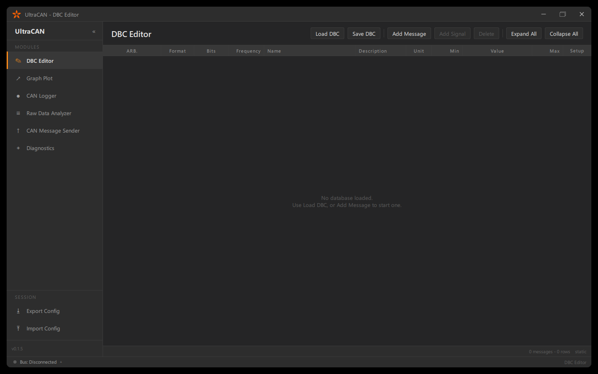
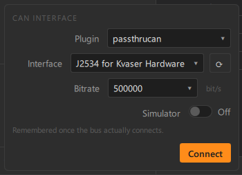
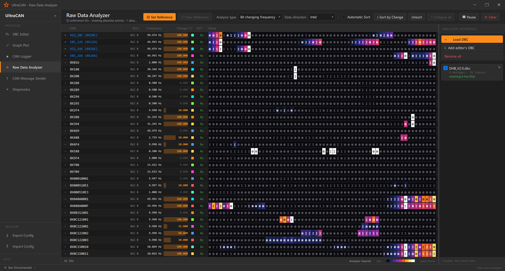
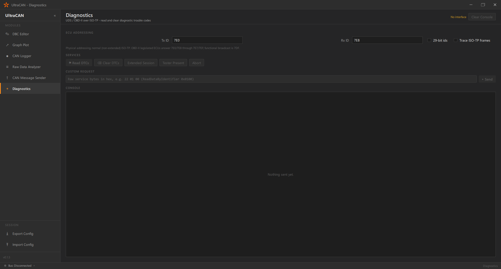
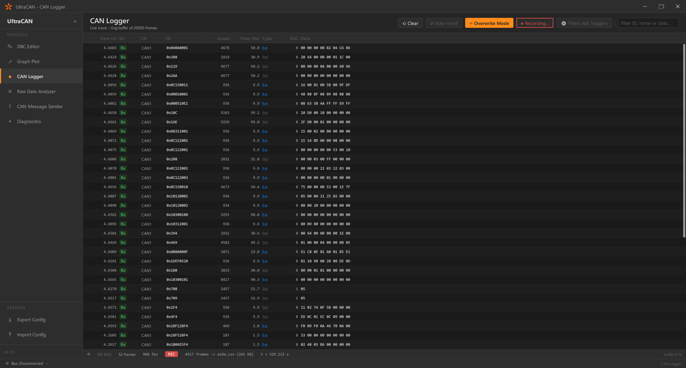
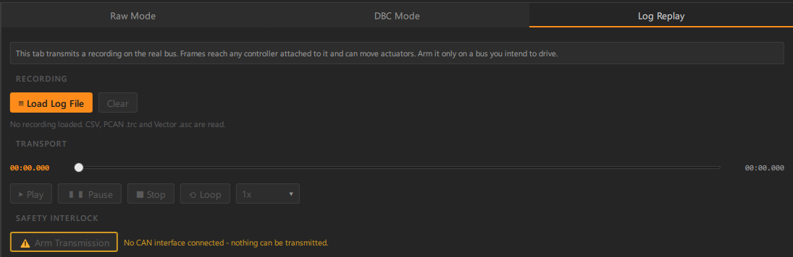
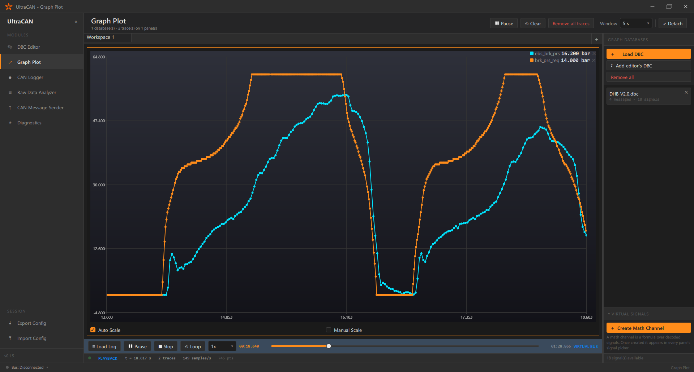
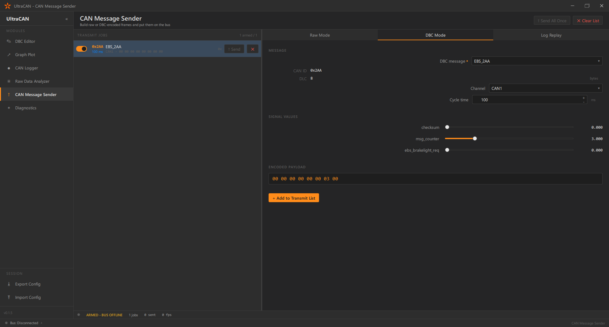
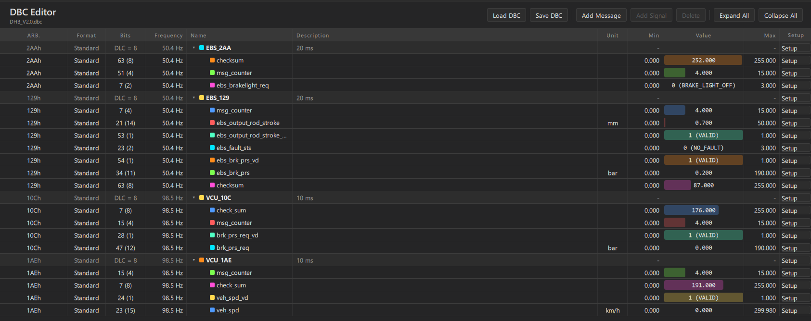

<div align="center">


# UltraCAN

**A professional CAN bus analysis, diagnostics and reverse-engineering workbench.**

[](https://en.cppreference.com/w/cpp/20)
[](https://www.qt.io/)
[](#building-from-source)
[](LICENSE)
[](../../releases)

[Download](../../releases) · [Features](#core-features--user-guide) · [Build from source](#building-from-source) · [Hardware support](#hardware-support)

</div>

---

## What it is

UltraCAN is a desktop workbench for people who have to understand a CAN bus — not just watch it
scroll past. It covers the whole loop an automotive engineer or security researcher actually works
through: connect to the hardware, capture traffic, work out what the bytes mean, describe them in a
database, plot them, talk to the ECUs, and replay the result back onto the wire.

It is built as a native Qt 6 / C++20 application. There is no runtime to install, no browser, no
telemetry. The UI is a single dark-themed window with six modules, and the backend is plain Qt —
frames are handled on the driver thread and handed to the UI in batches, so a busy bus does not
turn into a dropped-frame problem.

**Who it is for**

- **Automotive & embedded engineers** — bring up an ECU, verify a signal, log a fault, replay a bench recording.
- **Security researchers & tuners** — find the moving bits on a bus nobody has a `.dbc` for, then turn them into named signals.
- **Diagnostics work** — UDS and OBD-II over ISO-TP, including reading and clearing trouble codes.



---

## Core features & user guide

### Hardware connection

Click the bus indicator in the status bar to open the connection panel: pick a backend plugin, pick
an interface, pick a bitrate, connect. A **⟳ Refresh** button next to the interface list re-scans the
driver stack, so a USB analyzer plugged in after launch appears without restarting the application.
The last working plugin, interface and bitrate are remembered.

No hardware on the desk? A built-in **simulator** generates synthetic traffic so every module can be
explored offline, and Qt's `virtualcan` backend gives you a real loopback bus between two processes.



> See [Hardware support](#hardware-support) for the exact list of adapters and an important note on Kvaser.

### Raw Data Analyzer (sniffer)

The module for a bus with no database. Every arbitration ID gets a row, and every row shows its
payload as a **live bit and byte heatmap**: bits that toggle often burn bright, bits that never move
stay dark. A counter that increments, a flag that flips when you press a button, a 16-bit value that
tracks the throttle — all of them are visible as shape and motion before you know what any of them
are called.

Once you have spotted a field, you can turn the selected bits straight into a signal definition and
hand it to the DBC Editor. This is the fastest path from "undocumented bus" to "named signal".



### UDS / OBD-II diagnostics

A full ISO 14229 tester on top of an ISO 15765-2 (ISO-TP) transport written for this project.

- **ISO-TP transport** — Single, First and Consecutive Frames with proper Flow Control, block size and STmin handling, 11-bit and 29-bit addressing, and messages up to 4095 bytes.
- **Read DTCs** (`0x19 02`) — trouble codes decoded to standard notation (`P0128-00`) with their status bits spelled out (`confirmed`, `pending`, `testFailed`…).
- **Clear DTCs** (`0x14`) — behind a confirmation dialog, because it also erases the freeze-frame data an intermittent fault may only produce once.
- **Session control** (`0x10`), **Tester Present** (`0x3E`), **ReadDataByIdentifier** (`0x22`).
- **Custom requests** — type raw service bytes (`22 01 00`, `2201 00`, `0x22 0x01 0x00` all parse) and read the raw answer.
- **Console** — a timestamped, colour-coded transcript of requests, responses, negative responses and, optionally, the individual ISO-TP frames underneath them.

Negative responses are decoded to their standard meaning rather than shown as a hex code, and
`0x78 requestCorrectlyReceived-ResponsePending` is handled properly — the tester keeps waiting
instead of reporting a failure, which is what slow services like Clear DTCs need.



### Advanced CAN Logger

A live trace with a background writer that streams to disk independently of what the on-screen list
is doing.

- **Triggers** — arm the logger and let it wait. Start and stop conditions can be a CAN ID or a *decoded signal value* (`EngineSpeed > 4000`), with a **pre-trigger buffer** that keeps the last N seconds of traffic in memory so the frames *before* the event are in the file too.
- **Pass filters** — whitelist a single ID, an ID range, or match on a payload mask (`byte 2 & 0x0F == 0x03`). Filtering happens before the ring buffer, so a filtered-out frame can never fire a trigger.
- **Overwrite mode** — collapse the view to one row per ID to watch cycle times and value churn instead of a scrolling wall.
- **Export** — CSV, Vector ASCII (`.asc`) and PCAN (`.trc`).



### Log replay (restbus simulation)

Load a recording and transmit it back onto the physical bus with its original inter-frame timing,
so the recorded ECUs appear present to whatever is still on the bench.

Timing is driven by a dedicated pacer thread using a two-stage wait — a sleep down to a few hundred
microseconds of the deadline, then a short spin — because the OS scheduler alone cannot reproduce
sub-millisecond gaps.

**Safety:** physical transmission lives only in the CAN Message Sender's *Log Replay* tab, never in
the analysis views, and it sits behind an explicit **arm** interlock with a hazard confirmation.
Play does nothing until armed, and the interlock clears itself on stop, on loading a different file
and if the bus drops.



### Graph plotting & image export

Real-time and offline signal plotting with a splittable pane tree — divide a pane left/right/up/down
to any depth, each pane scaling its own Y axis over its own traces so a 0–8000 rpm trace does not
flatten the boolean next to it.

- **Workspaces** — multiple graph tabs, each detachable into its own window for a second monitor.
- **Math channels** — define virtual signals from a formula over real ones (`(a + b) / 2`, `sin(a)`), plot them like any other trace, and save them with the session.
- **Cursors and zoom** — box zoom, per-axis pan, auto/manual scaling.
- **Export as image** — right-click any pane and save exactly what you see as PNG or JPEG.



### CAN Message Sender

Compose frames by hand or from a loaded database, schedule them cyclically, and arm them
individually. Raw mode for byte-level work, DBC mode for building a frame from named signals with
their scaling applied.



### DBC Editor

Author and edit CAN database files without leaving the application. Messages, signals, bit layout,
scaling, offsets, units, value tables and comments — with a **live value column** that decodes the
signal against the bus as you edit, so you can see immediately whether the definition is right.



### Sessions

The whole workspace — loaded databases, graph panes and tracks, math channels, logger triggers and
filters — saves to a single `.ucan` session file and restores in one step. Databases are embedded
in the file rather than referenced by path, so a session mailed to a colleague opens on their
machine.

---

## Hardware support

UltraCAN talks to hardware through Qt's `QCanBus` plugin layer, so any backend your Qt build ships
is available. A stock Qt 6.8 Windows build provides:

| Backend | Plugin | Notes |
| --- | --- | --- |
| **PEAK-System** | `peakcan` | PCAN-USB and family |
| **Vector** | `vectorcan` | Requires the Vector XL driver library |
| **SYS TEC** | `systeccan` | |
| **TinyCAN** | `tinycan` | |
| **J2534 PassThru** | `passthrucan` | Any adapter with a J2534 PassThru driver |
| **SocketCAN** | `socketcan` | Linux only |
| **Virtual** | `virtualcan` | Loopback bus, no hardware needed |

> **Kvaser is not natively supported.** Qt ships no Kvaser backend, so there is no `kvasercan`
> plugin to select. Kvaser devices that expose a **J2534 PassThru** driver may work through the
> `passthrucan` backend — untested here; reports welcome.

---

## Installation

**No installer required.** UltraCAN ships as a self-contained folder.

1. Download the latest `UltraCAN-<version>-windows-x64.zip` from the [Releases](../../releases) page.
2. Extract it anywhere — a USB stick and a network share both work.
3. Run `UltraCAN.exe`.

Everything Qt needs travels in the folder; no Qt installation, no runtime, no registry changes.
Settings are written to `%APPDATA%\Basri Arzuoglu\UltraCAN\UltraCAN.ini` and nowhere else, so deleting the
folder removes the application.

An optional `UltraCAN_Setup.exe` installer is also published for anyone who wants Start-menu and
desktop shortcuts and a proper uninstall entry.

### Requirements

- Windows 10 or 11, 64-bit.
- The driver for your CAN adapter (PEAK, Vector, SYS TEC or a J2534 PassThru driver), installed as that vendor documents.

---

## Building from source

### Prerequisites

- **Qt 6.8** or newer, with the `SerialBus`, `Charts`, `Quick`, `QuickControls2` and `QuickDialogs2` modules.
- A C++20 compiler — MinGW 13 (shipped with Qt) or MSVC 2022.
- **CMake 3.16+** and Ninja.
- *Optional:* [Inno Setup 6](https://jrsoftware.org/isinfo.php) to build the installer.

### Build

```bash
git clone https://github.com/basriiarzuoglu/UltraCAN.git
cd UltraCAN/UltraCAN

cmake -S . -B build/release -G Ninja \
      -DCMAKE_BUILD_TYPE=Release \
      -DCMAKE_PREFIX_PATH="C:/Qt/6.8.3/mingw_64"

cmake --build build/release
```

Or simply open `UltraCAN/CMakeLists.txt` in Qt Creator and pick a kit.

### Packaging a standalone build

The project wires `windeployqt` into a CMake target, so producing a redistributable folder is one
command:

```bash
cmake --build build/release --target Deploy          # -> build/release/deploy/
cmake --build build/release --target CreateInstaller # -> build/release/installer/UltraCAN_Setup.exe
```

`Deploy` stages the executable plus every Qt DLL, QML module and plugin it needs into a clean
directory that runs on a machine with no Qt installed. `CreateInstaller` packages that directory
with Inno Setup.

### Project layout

```
UltraCAN/
├── main.cpp                 # entry point, singleton registration, wiring
├── Main.qml                 # application shell: title bar, sidebar, status bar
├── CMakeLists.txt           # build, deployment and installer targets
├── src/                     # C++ backend  (module: UltraCAN.Core)
│   ├── can/                 #   QCanBus device wrapper
│   ├── core/                #   bus manager, config, trace I/O, replay pacer
│   ├── dbc/                 #   .dbc parser and decoder
│   ├── models/              #   Qt models behind each view
│   ├── uds/                 #   ISO-TP transport and UDS client
│   └── ui/                  #   custom scene-graph items
└── qml/
    ├── theme/               # design tokens          (UltraCAN.Theme)
    ├── components/          # reusable widgets       (UltraCAN.Components)
    ├── models/              # QML-side models        (UltraCAN.Models)
    ├── views/               # one file per module    (UltraCAN.Views)
    └── routing/             # the navigation table   (UltraCAN.Routing)
```

The module graph is acyclic: `Core` sits at the bottom, then `Theme → Components → Views → Routing`.

---

## File formats

| Format | Read | Write | Used for |
| --- | :---: | :---: | --- |
| `.dbc` | ✔ | ✔ | CAN database definitions |
| `.ucan` | ✔ | ✔ | Full session (databases, graphs, math channels, triggers, filters) |
| `.csv` | ✔ | ✔ | Trace export and replay |
| `.asc` | ✔ | ✔ | Vector ASCII trace |
| `.trc` | ✔ | ✔ | PCAN trace |
| `.png` / `.jpg` | — | ✔ | Graph pane image export |


---

## Roadmap

- CAN FD support
- Kvaser backend (via a `QCanBusDevice` plugin or the J2534 bridge)
- Scripting for automated test sequences
- UDS security access and flash/download services
- Linux packaging (AppImage)

---

## Contributing

Issues and pull requests are welcome — bug reports from real hardware are especially valuable, since
the ISO-TP and replay timing paths can only be fully validated against real ECUs.

When reporting a bug, please include your adapter model, the backend plugin in use, the Qt version
and, where possible, a short `.asc` or `.csv` trace showing the problem.

---

## License

Released under the [MIT License](LICENSE).

## Acknowledgements

Built with [Qt 6](https://www.qt.io/). Trace format compatibility follows the conventions used by
PEAK-System and Vector tooling. UI design inspired by classic industrial DAQ software.

<div align="center">
<sub>UltraCAN — built by <a href="https://github.com/basriiarzuoglu">Basri Arzuoglu</a></sub>
</div>
